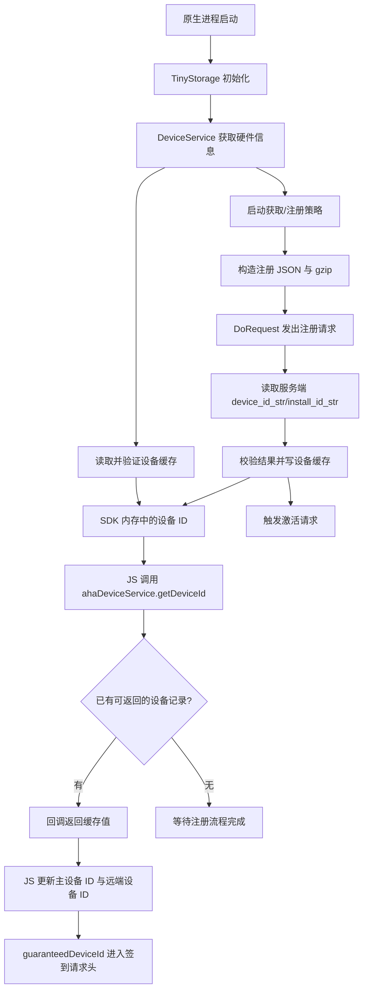

# Aha getDeviceId：注册、分配与缓存静态复核

> 本文保留早期静态分析。缓存加密、旧档案迁移、地区状态和回调时序等后续还原与验证见
> [原生模式还原与验收](AHA_GET_DEVICE_ID_NATIVE_PARITY_2026-11-20.md)。

日期：2026-11-20。目标：本机 Windows x64 Trae CN 3.4.20。

本轮只读取安装包、PE 数据与 JS 文件；没有运行 Trae、读取运行时设备缓存/账号凭据、
修改硬件标识或访问注册、激活、登录、签到服务。

EXE SHA-256：`eac5743ab3eafa528ae766a11a814cd0d8ea1c54cb948c66027e71479fe00ede`，
与既有分析基线一致。地址均为 PE RVA，不是文件偏移或进程地址。
新证据：`AHA_DEVICE_CACHE_STATIC_EVIDENCE_2026-11-20.json` 中 12 组有界反汇编片段；
完整本地中间产物位于 `logs/aha-static-20261120/`，已被 Git 忽略。

## 1. 总体链路



图中网络分支是静态可达路径，本轮未实际运行。
启动策略还会考虑地区/配置和网络状态，不应简化为“每次 getDeviceId 都注册”或“有缓存永不注册”。

## 2. getDeviceId 的原生桥接

`0x004c29f0–0x004c2b7f` 是带有 GetDeviceId 日志标签的桥接函数：

- 将调用方提供的旧 ID 交给 `0x02849440` 的迁移/设置路径。
- 取得 DeviceService 单例，调用 `0x0284a040`，将结果回传异步调用方。
- `0x0284a040` 在设备 ID 内存字段非空时走带有
  `has cache, directly return cache` 日志的分支，分发已等待的回调。
- 没有 ID 时把回调放入等待列表，而非在该函数里随机构造一个注册 ID。

注册获取有单独的启动/重试路径：`0x02848f30` 调用策略判断 `0x02849050`，
需要时进入 `0x0284a5d0 → 0x0284a240`。
`0x02849050` 检查 ID 能否解析为非零数值，并额外检查地区 CN 与另一配置状态。
本轮没有为未命名的配置位赋予猜测性的业务名称。

失败后的调度见 `0x0284e9e0`，网络恢复入口见 `0x0284d7f0`。
这属于原生设备注册重试，不是签到 claim 的自动重试。

## 3. device ID 如何分配

注册构造与网络发送路径：

```text
RegisterDevice 0x0284a240
→ BuildRegisterDeviceRequest 0x0284a710
→ JSON body；gzip framing 的压缩调用
→ DoRequest 0x02849d30
→ 注册响应回调 0x0284b820
→ ParseRegisterDeviceResponse 0x0284c490
```

原生请求模板包含应用/渠道/OS/版本信息，以及 pc_uuid、pc_serial；
JSON header 还包含 mc、device_model 等字段。
压缩调用的 windowBits 为 31，支持 gzip framing 的判断；
最终网络层在哪一步附加 Content-Encoding 等完整出站头，本轮没有抓包确认。

响应回调先检查网络结果及 HTTP 200，再进入 JSON 解析，读取
`device_id_str` 与 `install_id_str`，并复制到 DeviceService 的 ID 字段。
随后检查 device ID 非空且不为字符串 "0"；错误结果不会按成功路径持久化。
客户端没有在这一成功分支中根据硬件字段自行计算数值 device ID。

因此能确认：**被使用的注册 ID 来自服务端响应**。
不能确认：服务端是否每次分配新 ID、是否按硬件去重、哪些字段参与该算法、是否还有其他关联信号。
本轮不将 Python 注册器更严格的双 ID 正整数校验反推为原生代码的全部行为。

## 4. 原生缓存格式与持久化

### 4.1 存储层

TinyStorage 的设备缓存逻辑键为 `aha.device.device_id`。
该键并非仅保存一个裸数字，而是保存封装后的记录字符串。

- 加载入口：`0x02848e10`，读取该键，再调用 `0x0284c9e0` 解析。
- 序列化入口：`0x02849a70`，构造 JSON，调用设备服务 util 的加密封装，再进行 Base64 编码。
- 反向路径：Base64 解码后进入对应解密封装，再解析 JSON。
- TinyStorage SetValue：`0x0284d0a0` 更新存储对象并调用 Save。
- Save：`0x0284f460` 写入 `tiny_storage_data`；存在未初始化、需要稍后 flush 的分支。
- `0x0284f390 / 0x0284f6b0` 含有从旧 Preferences 数据迁移的路径。

初始化 `0x0284efe0` 静态构造的文件位置为：

```text
<启动路径服务提供的基目录>\aha\TinyStorage
```

启动调用者 `0x0020f860` 通过 PathService 键 0x2afa 传入基目录；
路径提供者 `0x00210c00` 将它转到键 0x3e9。
本轮没有读取实际文件，也没有完整确认该键在所有启动参数下的绝对路径映射，
因此不把上述相对路径写成固定的实际用户目录。

本轮确认了加/解密封装和 Base64 这一调用顺序，未完整展开内层密码格式、认证属性和所有密钥来源。
不能仅凭“缓存加密”断言它具有硬件真实性或服务端认可的持有证明。

### 4.2 明文记录结构与加载条件

序列化/解析代码确认的记录字段为：

```text
device_id_str
install_id_str
uuid
version = "1.2"
```

这里的 1.2 是缓存格式版本，不是 Trae 应用版本。
`0x0284c9e0` 中至少执行以下条件检查：

1. 外层解码/解密结果非空，JSON 可解析。
2. 可取得上述四个字段，version 与 "1.2" 匹配。
3. device_id_str 能由数值解析函数处理，且结果非零。
4. 缓存 uuid 与 DeviceService 已读取的当前硬件 UUID 长度和内容一致。
5. 检查通过才把缓存 device/install ID 放入返回结果。

失败日志统一提到 `cache uuid is not equal system uuid or cache did is local did`。
但实际所见分支是“ID 数值解析/非零 + UUID 比较”；本轮未见直接拿缓存 ID
与整个 localDeviceId 字符串做相等比较，不能把日志文案当成额外已还原的判断。

### 4.3 写缓存与激活的先后

注册成功回调在 `0x0284c204` 调用设备缓存写入，之后在 `0x0284c280`
调用激活入口 `0x0284c820`。另有按配置控制回调返回时点的分支。

因此：**缓存存在不单独证明激活已成功确认，也不证明缓存里的 ID 当前仍获服务器接受**。
缓存 JSON 中没有本轮可见的账号 ID、OAuth 公钥、设备日限或激活成功状态字段。

## 5. 硬件字段来源及可能影响

| 字段 | 静态来源/处理 | 已确认的本地作用 | 服务端作用的证据边界 |
|---|---|---|---|
| pc_uuid / uuid | 原生设备信息 UUID；Windows SMBIOS 来源；无效 UUID 时有 WMI 查询回退 | 注册 URL/JSON 输入；与缓存 uuid 比较 | 很强的候选设备关联字段，但服务端去重权重未知 |
| pc_serial | 磁盘序列号；可见 PhysicalDrive0、OS 磁盘、首个有效磁盘的回退路径 | 注册及激活输入 | 未证明是否必需、是否单独或组合参与识别 |
| mc | MAC；优先用户级注册表缓存，缺失时查系统适配器并缓存 | 写入注册 JSON header | 未证明服务端是否依赖；也不能假定每次都取当前适配器值 |
| device_model | Aha 设备信息型号 | 注册 JSON header | 可能用于一致性/策略判断，无本地唯一性比较证据 |
| os / os_version / device_platform | Windows/PC 与系统 release 信息 | 注册参数及 header | 上下文字段，服务端权重未知 |
| app/aid/channel/package/version | 应用启动配置 | 请求上下文与版本标识 | 未确认注册去重的作用域是否由其中某字段决定 |
| 时区、地区、语言、display_name | 系统/应用配置 | 注册 JSON header | 未确认其在服务端设备识别中的用途 |

这些都是客户端采集后提交的数据；本轮未在该请求构造中看到硬件签名或硬件背书结构。
这不等同于已经证明服务端信任所有声明，亦不排除未观测的其他风控信号。

### UUID 的两个不同用途

- 设备服务本地 ID 路径 `CalcLocalDeviceId`（`0x01d5ee60`）：设备信息对象存在时取其 UUID；
  对象不存在时有随机 UUID 形状的回退。这个本地 ID 不是服务端分配的数值设备 ID。
- 注册硬件输入路径 `GetHardwareInfo`（`0x02846a70`）：检查 UUID 格式及全零/全 F 情况，
  存在 `Win32_ComputerSystemProduct.UUID` 的 WMI 回退。
- Windows UUID 格式化函数 `0x01d3aaf0` 使用大写字段格式；此前 SMBIOS 字节序结论仍适用。

两个用途的回退条件不同，不能合并为“UUID 无效时一定随机生成新注册设备”。

### MAC 的独立缓存

`GetHardwareInfo` 静态引用用户级注册表路径 `Software\DeviceInfo\MacAddr` 与值名 `mac`。
可见 HKCU 常量、读取缓存、系统取值、写回缓存及失败日志。
它与 TinyStorage 中的 device/install ID 缓存是两种不同的持久化。
本轮仅从 EXE 常量和指令读取该路径，没有访问实际注册表值。

### 没有证据直接参与此注册请求的字段

制造商与 CPU 等信息会在其他系统信息/登录路径出现，但已检查的注册 builder
没有明确的 manufacturer/CPU 独立 JSON 字段。
OAuth MachineID、公钥和 P-256 签名也没有进入这个注册 builder。
不能把“客户端其他模块收集过”写成“本次设备注册一定发送”。

## 6. 对设备可信性的结论

已确认：UUID 会影响客户端缓存是否复用；UUID、磁盘序列号、MAC 等会进入注册请求；
最终数值 device/install ID 来自注册响应；已成功缓存的设备记录可供 getDeviceId 回调返回。

尚未确认：这些字段如何影响服务端的设备归并、账号绑定和签到日限。
随机更换安装密钥不会直接改变这里的硬件 UUID 或注册缓存；
客户端缓存校验本身也无法替代服务端对设备身份的校验。

本次没有更新本地 mock 的预设分组来冒充真实服务行为。

## 7. 可复核产物

- `tools/aha_device_static.py`：仅文件读取的 PE32+、.pdata、RIP 字符串引用和有界 Capstone 反汇编工具。
- `docs/AHA_DEVICE_CACHE_STATIC_EVIDENCE_2026-11-20.json`：12 组关键代码片段和映像指纹。
- `logs/aha-static-20261120/`：原始静态反汇编与索引；候选直接调用引用需结合函数内完整解码核对。

PE 没有 runtime function 记录的 leaf/thunk 使用有界窗口，并明确标记该边界来源；
它们不作为已恢复的完整 C++ 函数边界。本报告核心缓存/注册结论来自可定位的函数范围和指令分支。
