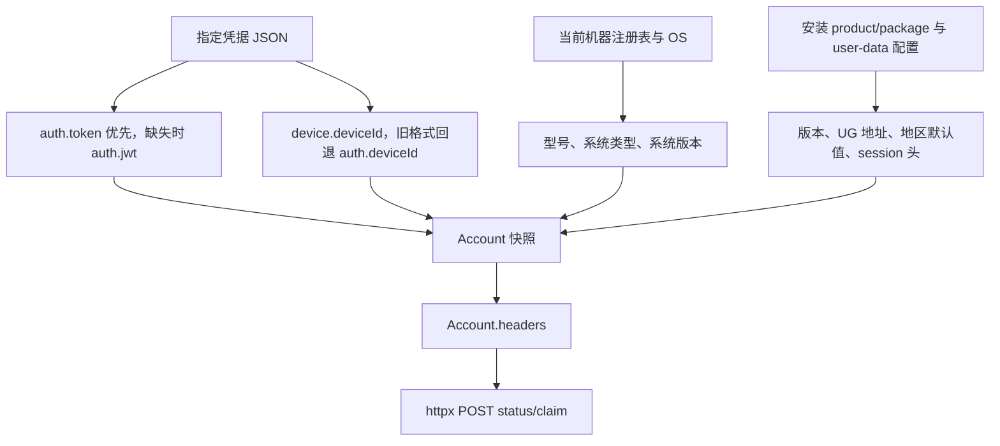
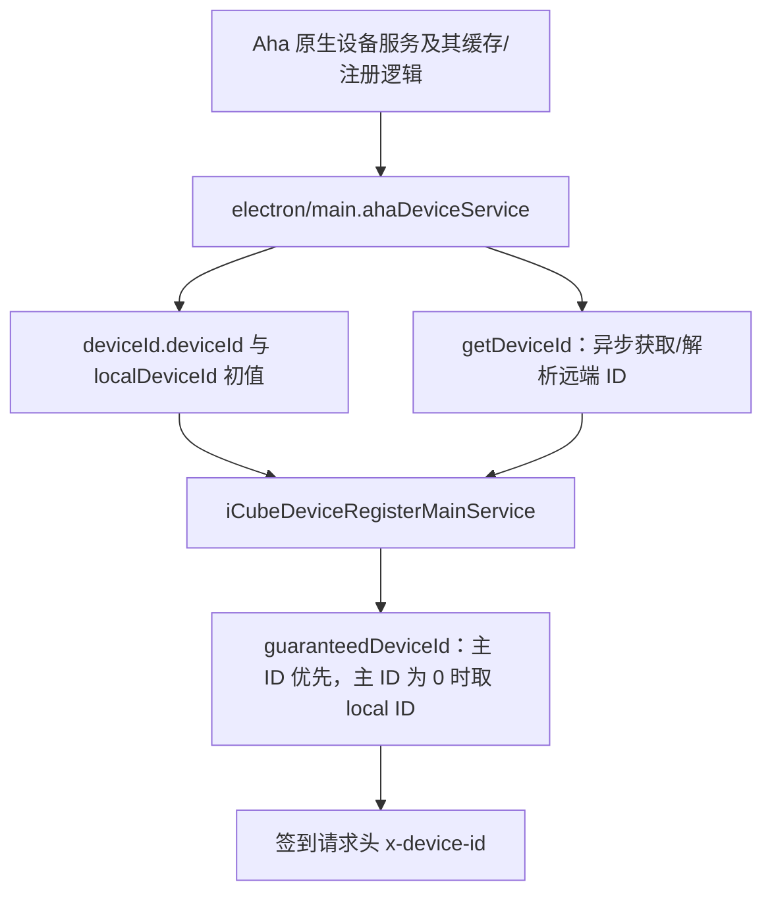

# 签到设备参数：Python 脚本与原生 Trae CN 链路对照

日期：2026-11-20。仅静态核对，没有读取真实账号值或发送网络请求。

本机安装仍为 Trae CN 3.4.20；本轮重新计算 main.js/workbench JS 的 SHA-256，
与既有证据一致，并逐字核对原始 13 个和补充 17 个源码片段，全部匹配当前安装。
这属于当前安装的静态构造证据，不是最终出站报文抓包。

## 1. 先区分两个脚本入口

- `trae2api.checkin`：面向真实签到接口，分 `--creds` 与 `--native` 两种身份来源。
- `trae2api.sandbox_lab`：仅本机 `/lab/*`，使用合成夹具、实验 P-256 密钥、mock session 和测试流水。

新生成的实验 P-256 密钥、物理分组与签名，没有自动注入生产 checkin.py。
本地 key_id、machine ID 与 mock physical ID 也不能当作生产签到设备参数。

## 2. Python 生产签到脚本

### 2.1 独立凭据入口：--creds



`Account.from_file()`：

1. 读取 token；读取明确指定的 deviceId。显式 deviceId 非法时不替换为别的身份。
2. 本地检查 token 的可解析 JWT exp；这不是服务端鉴权或签名验证。
3. 型号优先读取当前机器的 BIOS SystemProductName；缺失时才回退凭据 deviceModel/deviceBrand。
   若型号等于用户自定义 deviceName，则再次尝试真实型号。
4. OS 从当前机器读取；应用版本优先当前安装，缺失时回退凭据版本和已审查版本。
5. `CheckinProfile.load()` 补充安装配置和通用 session 请求头。
6. token/device ID 保留文件值，未在签到时重新注册设备、生成 ID 或刷新 token。

所以该模式的参数并非全部来自 JSON：账号和 deviceId 来自文件，多个描述头和通用标识可能来自当前机器/原生 user-data。
加载后使用 Account 快照；此路径没有原生模式的每请求身份复核。

如果凭据来自新版独立 login，其上游为：

```text
真实 Hardware.read
→ 独立设备配置缓存；需要时注册/激活取得远端 device/install ID
→ 同一 device ID、machine ID、公钥参与 OAuth
→ token 与 device 信息一同保存
→ checkin --creds 读取
```

旧凭据也可以被 checkin 读取；这不证明其 deviceId 已由新版注册流程产生。

### 2.2 原生身份读取入口：--native

```text
原生 storage.json 中的当前登录信息
  → 解密并读取 token、userId、marscode scope
最新会话 main.log
  → 核对远端解析 ID、初始化/超时后的解析顺序、store region
原生 storage 中对应的 OAuth 设备记录键
  → 核对该远端 ID 存在对应记录；不解密设备私钥
上述身份 + 当前机器元数据 + CheckinProfile
  → Account 快照
每次请求前重新加载 NativeIdentity
  → token/账号/设备/地区/会话改变则停止
  → 通过后构造请求头并由 httpx 发送
```

该路径通过日志和存储证据配对身份，不调用原生实时 guaranteedDeviceId getter。
它拒绝本地 fallback、不自动注册，也不读取实验目录的 P-256 密钥。

### 2.3 两种模式共享的头构造

`Account.headers()` 先写 Authorization、x-device-id、超时、UA、market client 与地区头，
再合并 CheckinProfile 的 session 头，最后补上非空的型号、OS 和应用版本头。

CheckinProfile：

- 安装 product.json/package.json：应用/编辑器版本、客户端名、静态 UG 地址。
- user-data/settings.json：环境 lane 与 telemetry 开关。
- 允许通用标识头时，从只读 state.vscdb 读取 storage.serviceMachineId；缺失时读取已有 machineid 文件。
- VSCode-SessionId 优先已有 telemetry.machineId，缺失时回退 serviceMachineId。
- 不创建原生 machineid；这些通用标识也不等于独立登录配置中的 OAuth MachineID。

CLI 还允许显式覆盖 base URL 与 user region；不应把覆盖后的参数自动称为原生值。

## 3. 真实 Trae CN 的静态可见链路

### 3.1 主设备 ID 的产生与选择



初始化会按迁移标记决定是否把旧 device_id 传给 SDK。
远端解析成功后更新主 ID 与远端 ID，并迁移/移除旧 device/install 存储项。
初始化超时且仍无有效主 ID 时可回退 local ID；异步远端解析稍后成功仍会更新服务内存值。
因此，原生发送时取的是服务当时的 guaranteedDeviceId，而不是每次签到随机生成的字符串。

Aha 内部涉及硬件信息、缓存与注册；并非每次 getter 调用都必然发起网络注册。
本轮未重新完整反汇编其所有分支，也没有推断服务端按何种硬件指纹归并设备。

### 3.2 设备描述与版本

```text
electron.ahaDeviceService.deviceInfo.model/manufacturer
  + Node os.version/release、平台映射
→ iCubeSystemInformationService
→ commonParams.device_model / os_name / os_version
product service.appVersion
→ commonParams.app_version
上述 commonParams 字段
→ 签到请求头构造 ob(headers)
```

其中 Windows os_name 映射为小写 windows，os_version 使用 Node os.version()。
brand 请求头取的是清洗后的 device_model，虽然名称含 brand，也不是 manufacturer。
commonParams 还包含 CPU、内存、machine_id 等信息，但 ob() 没有把整个 commonParams 发送到签到接口。

### 3.3 从界面到发送

```text
账号菜单/签到命令
→ claimIdeCheckinCredits：检查状态、账号资格与两个签到标记
→ Electron IPC
→ 主进程 claimCheckinCredits：合并同账号/日期的进行中请求
→ mb：读取当前登录 token，检查账号上下文，解析 UG API 地址
→ ob：实时读取 guaranteedDeviceId 和 commonParams 的设备描述
→ fetchWithHeaders / TTNet JS wrapper
→ Electron net.fetch
→ 可能匹配的 session webRequest 头处理
→ 原生网络栈出站
```

静态 session 规则可能补充或覆盖 Authorization、X-User-Region、User-Agent、
X-Market-Client-Id，以及条件性的 X-Market-User-Id、VSCode-SessionId 和环境头。
不能把可能匹配的规则等同于本次实际发送了所有这些头；最终出站报文未在本轮捕获。

## 4. 设备相关字段对照

| 字段 | Python checkin | 原生 Trae CN |
|---|---|---|
| x-device-id | --creds 文件值；--native 日志+存储核对后的远端值 | 发送时读取设备服务 guaranteedDeviceId，允许本地 fallback |
| x-device-brand | 当前 BIOS SystemProductName 优先；独立凭据有兼容回退 | HF(commonParams.device_model)，上游 Aha deviceInfo.model |
| x-device-type | 当前系统映射，Windows 为 windows | 系统信息服务映射，Windows 为 windows |
| x-os-version | Windows 注册表 ProductName 为主，其他平台使用 Python OS 元数据 | Windows 使用 Node os.version() |
| x-app-version | 当前安装 appVersion 优先，有兼容回退 | product service.appVersion，经 commonParams |
| User-Agent | 按安装 package.version 与 product.nameShort 显式构造 | marketplace session 规则构造；本次最终发送未抓包 |
| X-Market-Client-Id | VSCode 加编辑器版本 | marketplace session 规则使用编辑器版本 |
| X-Market-User-Id / VSCode-SessionId | 按配置条件读取已有原生存储后显式构造 | session header builder 按配置条件获取通用客户端标识 |
| X-User-Region | --native 会话日志地区；--creds 默认 CN；允许 CLI 覆盖 | store-region service；session 规则可补充/覆盖 |

型号、系统版本的来源已对齐到相近语义，但不代表当前运行值或所有回退分支完全等价。
应用版本 appVersion 与编辑器 package.version 是不同字段，不能混用。

## 5. 实际请求中没有显式携带的内容

两条生产路径的已检查签到构造均使用 POST 到 status/claim 路径。
普通 IDE 请求体为 `{"req_source":1}`；原生另一产品形态分支使用 2。

在这些可见构造中，未直接把硬件 UUID、磁盘序列号、MAC、installId、OAuth MachineID、
设备公钥、私钥、DeviceProof、ECDSA 签名、时间戳或 nonce 加进签到请求体。
部分字段可能已用于上游注册/登录，服务端也可能通过 token 或设备记录查到关联信息。
这不排除未观测到的原生网络层处理。

实验协议中的 P-256 签名验证及预设物理设备分组，不在上述真实签到链路内。

## 6. 证据入口

- `trae2api/checkin.py`：Account.from_file/from_native/headers、_post。
- `trae2api/native_identity.py`：NativeIdentity.load、ensure_current。
- `trae2api/checkin_profile.py`：通用 session 头读取。
- `trae2api/client_metadata.py`：安装版本、注册表型号、OS 元数据。
- `TRAE_CN_CHECKIN_STATIC_EVIDENCE_2026-11-19.json`：13 个原生源码片段。
- `TRAE_CN_CHECKIN_ADDITIONAL_STATIC_EVIDENCE_2026-11-19.json`：17 个系统信息、session 和网络封装片段。
- `TRAE_CN_CHECKIN_CALL_CHAIN_2026-11-19.md`：原生完整静态调用链及证据边界。
